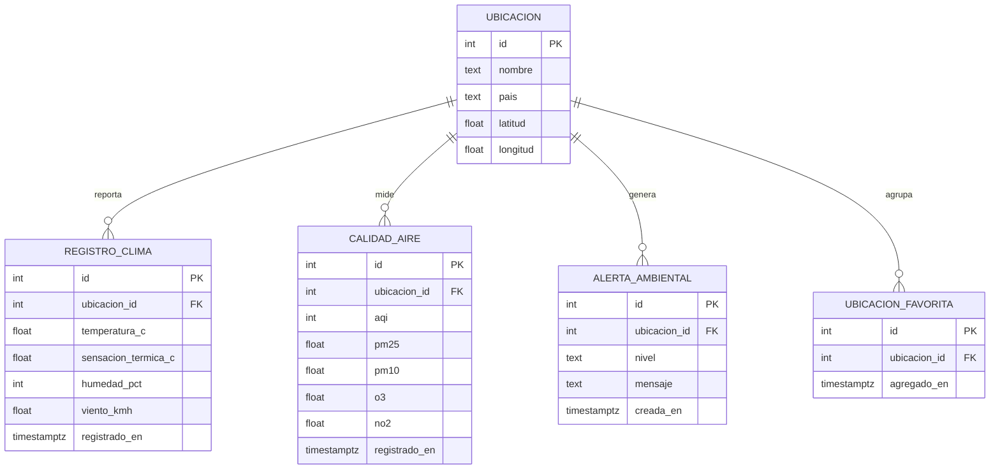

# PRD · Encanto del cielo

> Documento de requisitos del producto (Product Requirements Document).
> Complétalo en el Sprint 0 (historia H0.3) y pide la aprobación del profesor en un Issue.
> Cada requisito funcional (RF) se convierte en un Issue con la plantilla "Historia de usuario".

| Campo | Valor |
| --- | --- |
| Alumno | Anayerlis Daniela Chacoa Mota |
| Proyecto n.º | Lenguajes de programacion II- clima y calidad del aire |
| Sitio de referencia | Windy |
| Compañero revisor | por asignar |
| URL desplegada | (se completa en el Sprint 5) |

## 1. Problema

Muchas plataformas meteorologicas muestran datos tecnicos dispersos o interfaces saturadas que dificultan entender rapidamente como esta el clima y la calidad del aire en una ubicacion especifica. esto afecta a personas que planifican su rutina diaria. necesita informacion clara,visual y confiable

## 2. Usuarios

- **Usuario principal:** Ciudadano o estudiante que consulta el clima acyual,pronostico o calidad del aire de su ciudad desde el telfono movil o computadora antes de salir de casa.
- **Usuario secundario:** Persona con sensibilidad respiratoria o deportista al aire libre que necesita revisar indices de calidad del aire ,viento y alertas ambientales por zonas.

## 3. Objetivo y métrica de éxito

lograr que cualquier usuario consulte las condiciones climaticas y la calidad del aire de una ciudad y visualice los indicadores principales en menos de 5 segundo desde que carga la aplicacion

## 4. Alcance del MVP

Entre 5 y 8 funcionalidades que SÍ entran este semestre.

1. Consulta de clima actual (temperatura, sensación térmica, humedad, viento y presión) por ciudad o ubicación.
2. Pronóstico meteorológico por horas y por días.
3. Visualización del Índice de Calidad del Aire (AQI) y concentraciones de contaminantes principales (PM2.5, PM10, O3, NO2).
4. Mapa interactivo de clima y calidad del aire con capas visuales (inspirado en Windy).
5. Gestión de ciudades favoritas para acceso rápido.
6. Alertas y recomendaciones de salud según el nivel de calidad del aire y condiciones climáticas.


### Funcionalidades → carpetas de `src/` (screaming architecture)

Cada funcionalidad del alcance será una carpeta en `src/`. Nómbralas en inglés y en plural.

| Funcionalidad | Carpeta |
| --- | --- |
| Clima actual y pronostico| `src/sales` |
|calidad del aire y contaminacion |`src/air-qualities`|
| Mapas y capas visuales | `src/maps` |
| Ubicaciones y ciudades favoritas | `src/locations` |
| Alertas y recomendaciones | `src/alerts` |

## 5. Fuera de alcance

Lo que NO vas a construir.

- Aplicación móvil nativa para iOS o Android (el producto será únicamente web responsivo).
- Predicciones meteorológicas propias basadas en modelos de machine learning entrenados desde cero (se consumirán APIs meteorológicas y de calidad del aire existentes).
- Estaciones meteorológicas físicas o integración con sensores IoT personales.

## 6. Requisitos funcionales

| ID | Requisito | Prioridad (alta, media, baja) |
| --- | --- | --- |
| RF-01 | Buscar ciudades por nombre o usar geolocalización para consultar clima y calidad del aire | alta |
| RF-02 | Visualizar condiciones climáticas actuales (temperatura, sensación térmica, humedad, viento y presión) | alta |
| RF-03 | Consultar pronóstico meteorológico por horas y extendido por días | alta |
| RF-04 | Visualizar el Índice de Calidad del Aire (AQI) y niveles de contaminantes (PM2.5, PM10, O3, NO2) | alta |
| RF-05 | Explorar mapa interactivo con capas visuales de viento, temperatura y calidad del aire | media |
| RF-06 | Guardar y administrar una lista de ubicaciones favoritas para acceso rápido | media |
| RF-07 | Mostrar alertas y recomendaciones de salud según el nivel de AQI y clima extremo | baja |

## 7. Requisitos no funcionales

- Responsive, móvil primero (375 px y 1280 px).
- Lighthouse ≥ 90 en Accesibilidad y Buenas prácticas.
- 0 errores en la consola del navegador.
- Funciona con 10.000 registros sin congelarse.

## 8. Modelo de datos

Diagrama entidad-relación y tablas PostgreSQL con tipos, claves y restricciones.
GitHub dibuja diagramas Mermaid; edita este ejemplo:



## 9. Reto técnico distintivo

Reto técnico distintivo (H9.1) — Procesamiento y consulta ágil de series de tiempo atmosféricas y contaminantes (temperatura, AQI, PM2.5 y viento) por ubicación y ventana horaria sin congelar la interfaz ni saturar las peticiones externas.

## 10. Riesgos y preguntas abiertas

- Límites de tasa (rate limits) o latencia en las APIs externas de clima y calidad del aire durante picos de consulta.
- Disponibilidad o cobertura irregular de estaciones de calidad del aire (AQI / PM2.5) en ciudades secundarias o zonas rurales.
- Precisión de las alertas ambientales y criterios de umbral de AQI para recomendaciones de salud.
```

